# 📡 Signal Delay – NASA Space Apps Challenge 2026

**Challenge:** NASA Space Apps Challenge 2026 – Space Mission Design Game

Welcome to the official repository of **Signal Delay**, our project for the NASA Space Apps Challenge 2026.

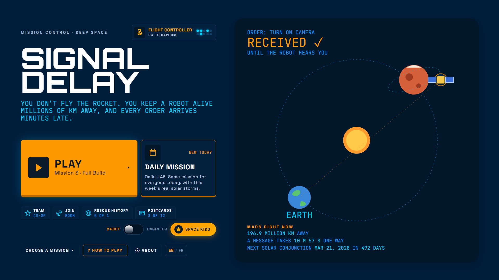

## 🚀 About the Name: Why "Signal Delay"?

**Signal delay** is the time a command or message needs to travel between Earth and a spacecraft far away in space.

Radio signals move at the speed of light, which is very fast, but space is very big. A spacecraft at Mars can be between **3 and 22 light-minutes** from Earth. That means a command sent from Earth can take many minutes to arrive, and the answer takes just as long to come back.

Our project is named after this challenge. In **Signal Delay**, players learn how real mission teams plan, make decisions and wait for their commands to reach spacecraft.

## 🌍 About the Challenge

**NASA Space Apps Challenge 2026 – Space Mission Design Game**

We created this project to make space exploration and science more accessible and exciting for everyone. Our audience includes **kids who dream of exploring space, students who want to apply what they learn, and curious people interested in science and engineering**.

Instead of keeping scientific knowledge only in textbooks and papers, we give players an opportunity to explore it through an interactive simulator based on real-life principles. They can design missions, send commands across space, make important decisions and discover the results of their choices.

## 👥 Our Team

We are here to **learn, have fun, share ideas, meet new people and enjoy the networking experience** while building something meaningful. 🌟

<table width="100%">
  <tr>
    <td align="center" valign="top" width="33%">
      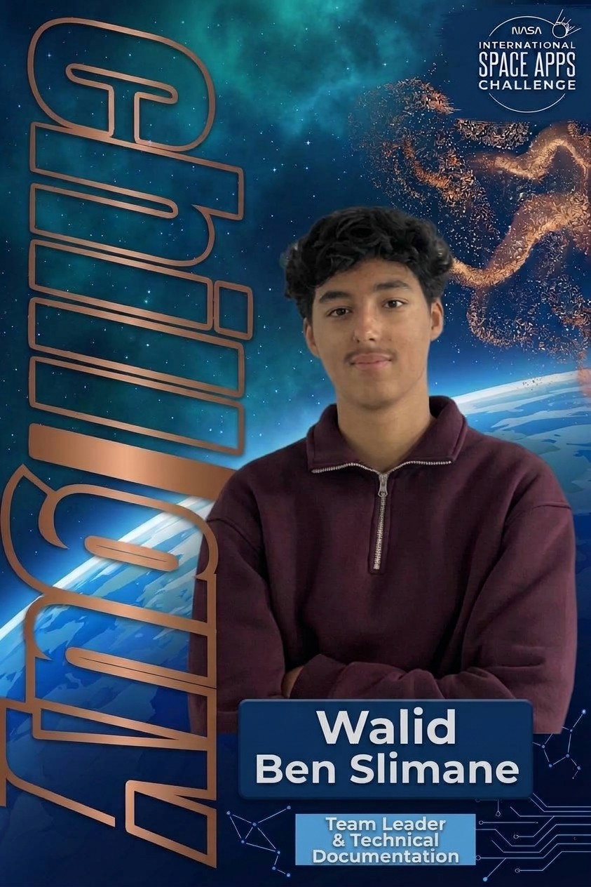
        
      <b>Walid Ben Slimane</b>
       
      Team Leader &amp; Technical Documentation
    </td>
    <td align="center" valign="top" width="33%">
      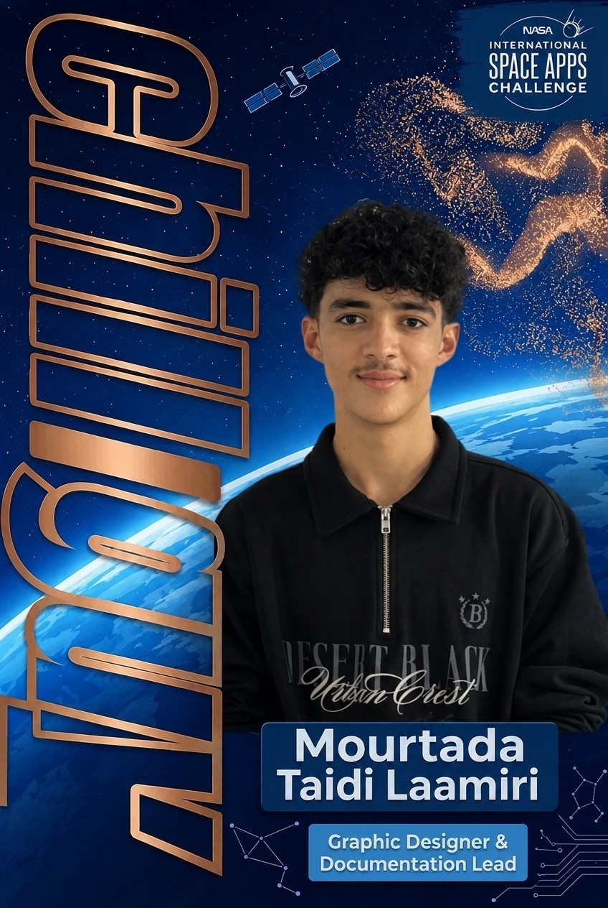
        
      <b>Mourtada Taidi Laamiri</b>
       
      Graphic Designer &amp; Documentation Lead
    </td>
    <td align="center" valign="top" width="33%">
      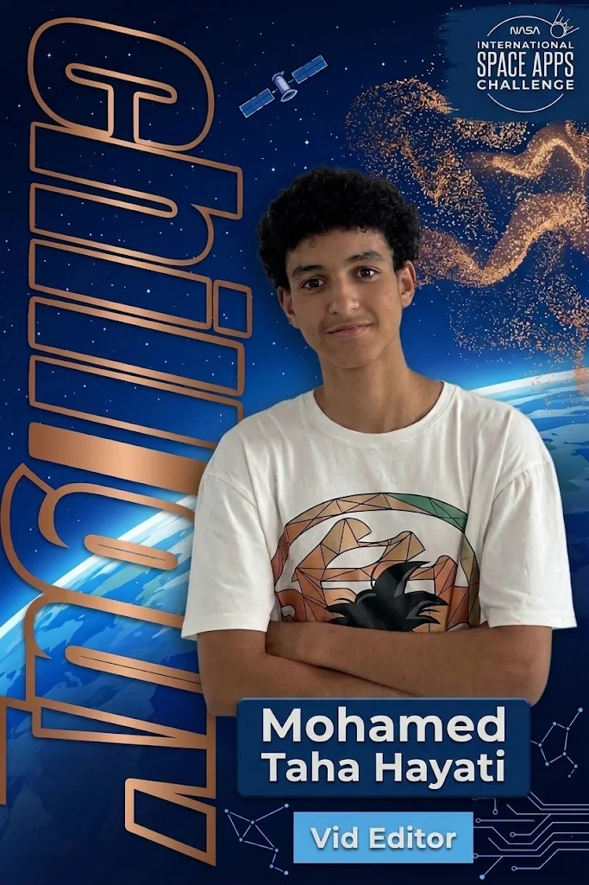
        
      <b>Mohamed Taha Hayati</b>
       
      Vid Editor
    </td>
  </tr>
  <tr>
    <td align="center" valign="top" width="33%">
      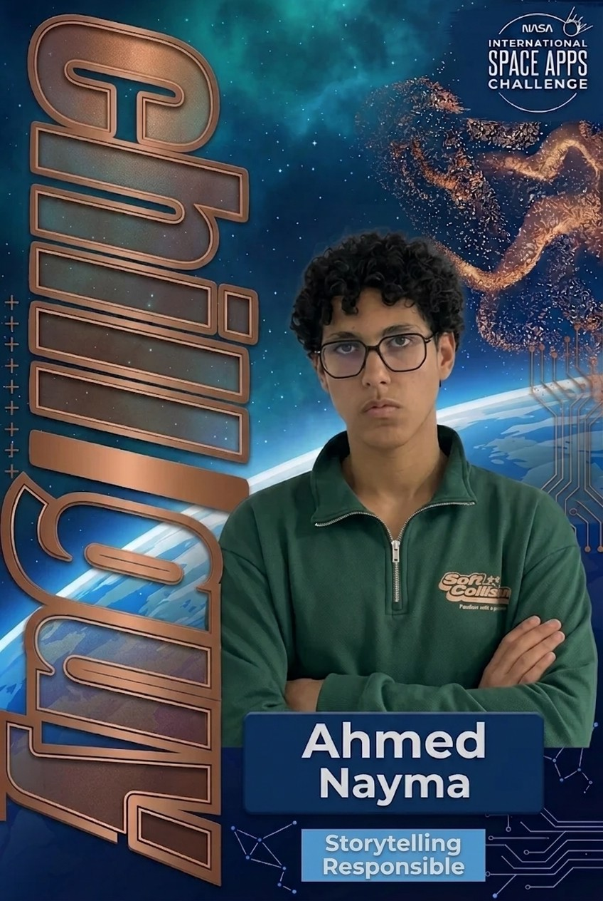
        
      <b>Ahmed Nayma</b>
       
      Storytelling Responsible
    </td>
    <td align="center" valign="top" width="33%">
      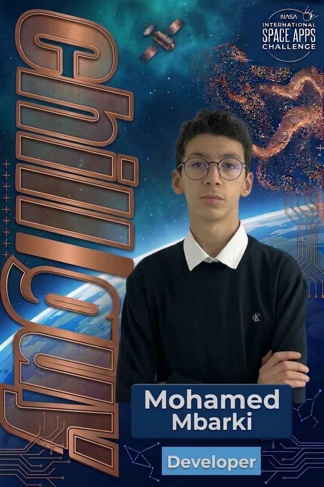
        
      <b>Mohamed Mbarki</b>
       
      Developer
    </td>
    <td align="center" valign="top" width="33%">
      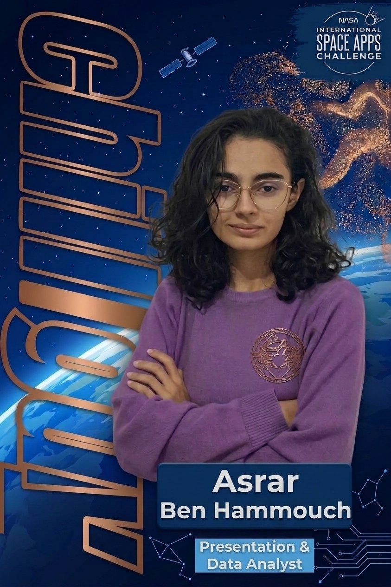
        
      <b>Asrar Ben Hammouch</b>
       
      Presentation &amp; Data Analyst
    </td>
  </tr>
</table>

## 🌌 Project Overview

**Signal Delay** is a browser game about the hardest part of robotic space exploration: **you are not there.**

A spacecraft at Mars is between 3 and 22 light-minutes from Earth. When a solar storm is coming, the team on the ground has to decide, send the order, and hope it crosses space before the danger arrives.

The game turns the work of a NASA mission team into three stages, allowing players of different ages and backgrounds to discover how space missions work.

### 1️⃣ Design (Pack)

First, you plan your mission:

- Choose the **mission objective**.
- Pick the **rocket** and the **science orbit** (the path the spacecraft follows around its target).
- **Pack the parts** that fit inside the nose of the rocket.

While you design, four limits are shown on screen: **weight, budget, power and data**.

Every choice is a trade-off. A bigger rocket can carry more, but it costs more. A different orbit changes how much fuel you use and which moons the spacecraft can reach. Scientific instruments also have different costs and benefits.

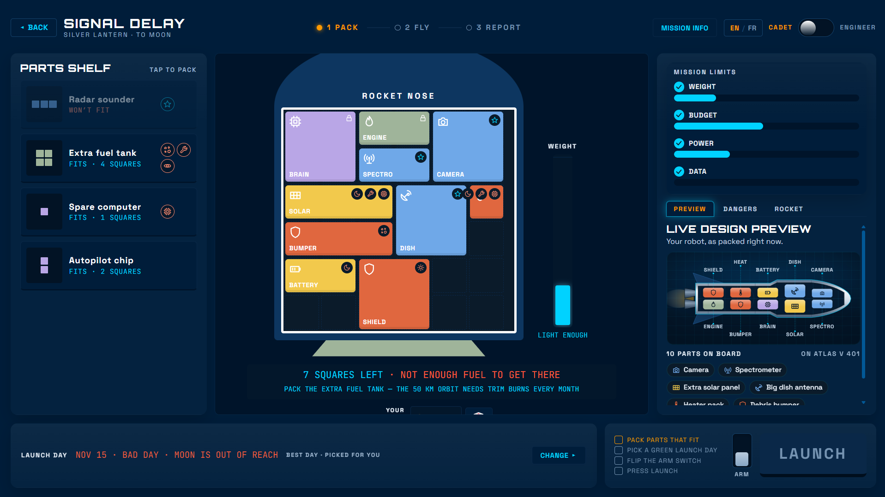

### 2️⃣ Fly & Survive

Now the mission runs **day by day**. When danger appears, you must choose how to respond.

Your commands travel through space at the speed of light, so the spacecraft **cannot receive them immediately**. You must think ahead.

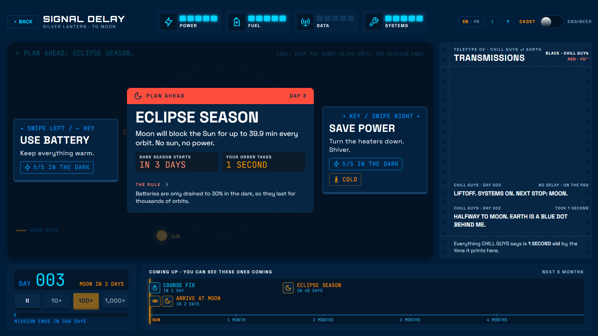

At Mars, the robot asks what it should observe. There are **six science targets**, and each observation has its own costs and risks. The pictures you take must also be sent back to Earth during communication opportunities with NASA's **Deep Space Network (DSN)**, the large antennas that talk to far-away spacecraft.

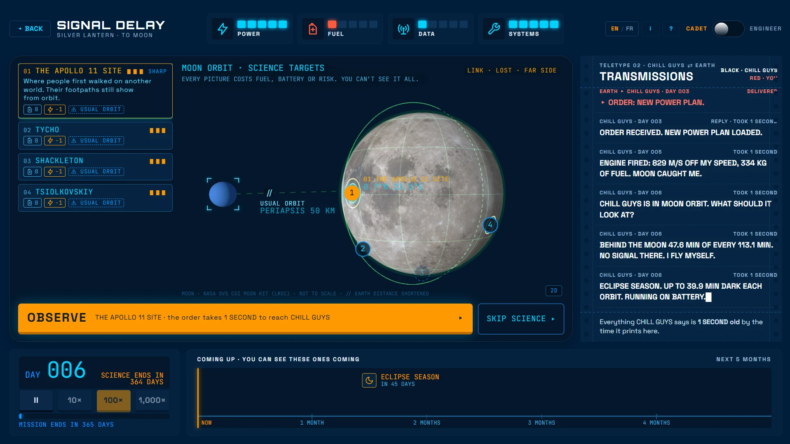

### 3️⃣ Mission Report

When the mission ends, you get a report that shows:

- Which pictures **reached Earth**.
- Whether you **completed your mission objective**.

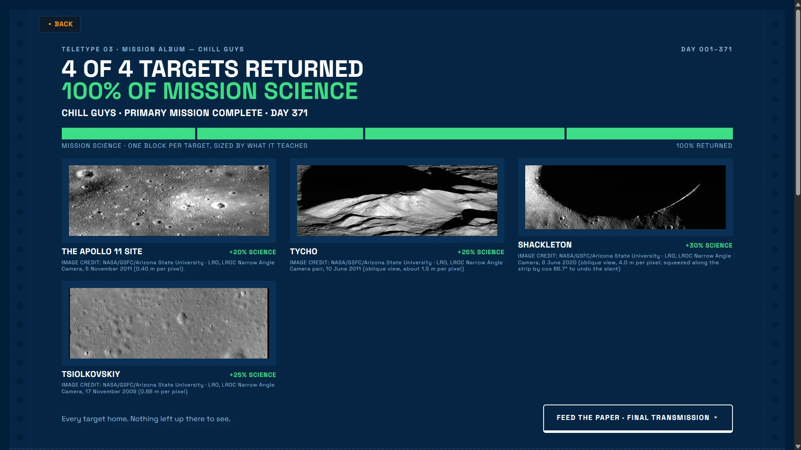

Your journey is shown as a **comic-style mission history**, with a **score** and a **comparison to a real NASA mission**.

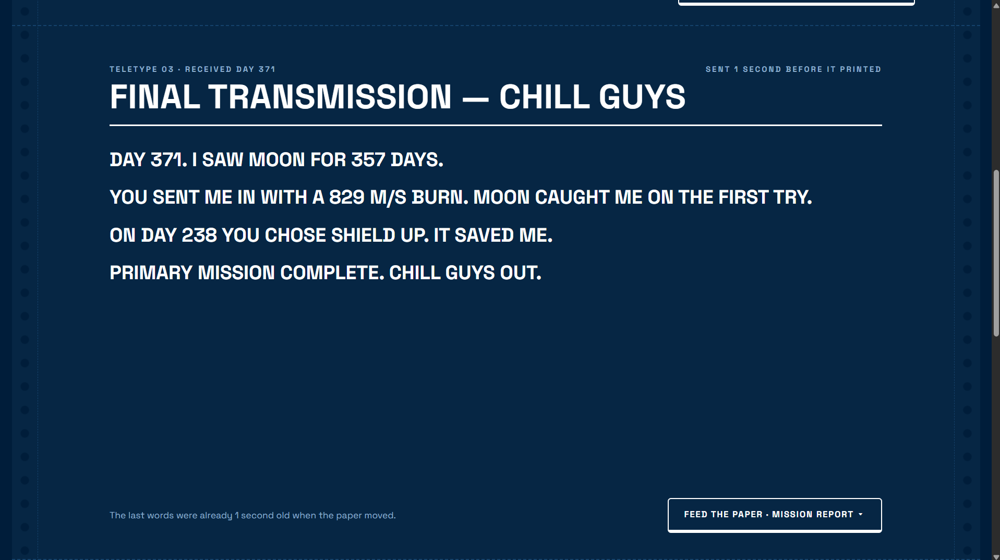

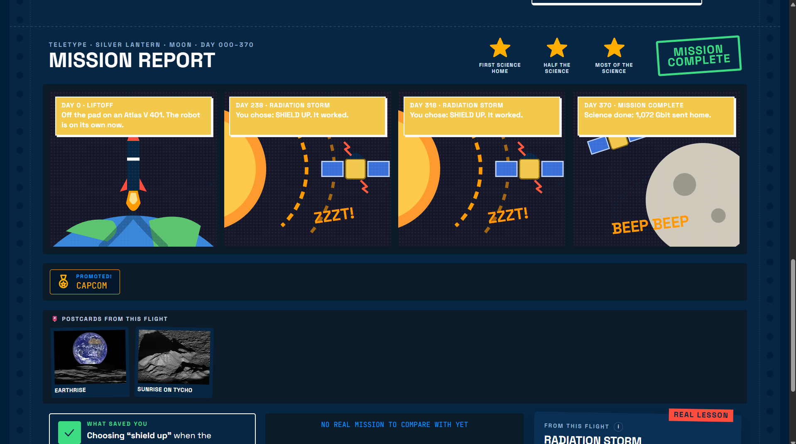

The report also explains **what you could have done better**. Then you can redesign your mission, **fly again**, and compare your new decisions with your previous mission.

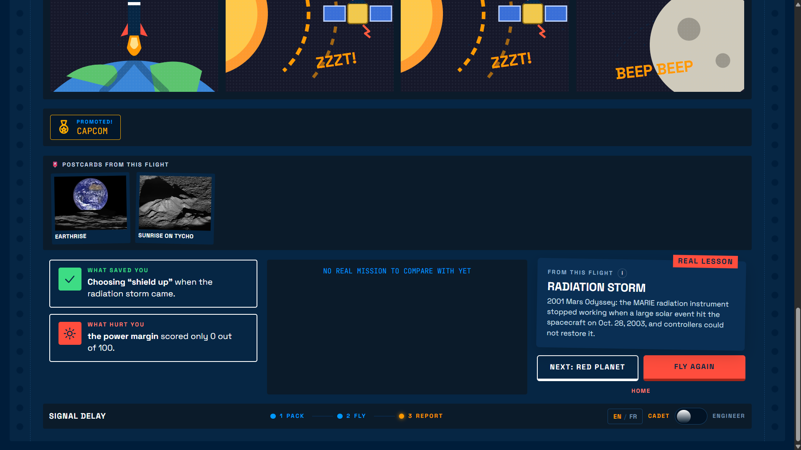

### 🎓 Two Learning Modes

- **🎒 Cadet Mode:** For students, younger learners and curious players who want to discover space missions through a simple and interactive experience.
- **⚙️ Engineer Mode:** For students, science enthusiasts and anyone who wants to explore the science and mathematics behind the simulation, including equations, inputs and data sources.

## 🧒 Space Kids – Discover the Universe!

**Space Kids** is a dedicated section of Signal Delay created for younger explorers who are inspired by space, science and the mysteries of the universe.

We believe curiosity about space can start at any age. This section aims to introduce kids to the fascinating world of space exploration and encourage them to discover, ask questions and develop an interest in science and technology.

Our goal is to make space feel closer to the next generation of explorers, scientists and engineers.

**Because today's curious kids could become tomorrow's space explorers!** 🚀

## ⚡ What Makes It Different?

Signal Delay is not an ordinary space game. Here is why.

### 🧩 Real Mission Decisions

Designing a mission is a real trade-off, not a shopping list. Your **objective** decides which instrument is useful. The **rocket** sets the weight limit, and a more expensive rocket takes money from your budget. The **science orbit** changes how much fuel is left, which moons you can reach, how much drag the spacecraft feels on low passes, and how long it spends in shadow.

The bars on screen move **before** you commit, so you can see the effect of each choice. Two players with the same parts but different orbits will get different science.

### 🕒 Communication Takes Time

Light delay is the core of the game. The delay of a command follows a simple rule: **time = distance ÷ speed of light** (`t = d / c`). The game uses the real distance between Earth and the spacecraft on each mission day.

Communication can also be interrupted. When the Sun is between Earth and the spacecraft (a *solar conjunction*), the radio signal is blocked for about two weeks. This also happens to real Mars missions.

### 🔬 Science Behind the Simulation

The numbers in the game come from physics or from a cited source, not from imagination:

- **Distances** come from JPL planetary positions.
- **Solar power** follows the inverse-square law (power drops quickly as you move away from the Sun), calibrated on the MAVEN mission.
- **Data rates** come from a link budget anchored to the Mars Reconnaissance Orbiter.
- **Launch energy** is calculated with a Lambert solver, a method for finding the path between two points in space.

### 🚀 Learning From Real Missions

Real NASA missions are flown through the same model as the player. **MAVEN** and **OSIRIS-REx** are loaded as ordinary designs, and they must reproduce their published numbers. If the model cannot do this, we fix the model, not the mission.

## 🛰️ Data Sources

Signal Delay uses scientific and planetary data to make its space mission simulation more realistic.

| Data | Used for | Link |
|---|---|---|
| Mars semimajor axis, orbit and synodic periods, radius, GM, distance from Earth (54.6–401.4 million km), solar irradiance, pole of rotation | Mars orbit, light delay, power, eclipses, dust-storm season | [Explore Data](https://nssdc.gsfc.nasa.gov/planetary/factsheet/marsfact.html) |
| Earth GM, equatorial radius, sidereal year; solar irradiance at 1 AU (1361 W/m²) | Launch and power calculations | [Explore Data](https://nssdc.gsfc.nasa.gov/planetary/factsheet/marsfact.html) |
| Venus GM, radius, solar irradiance (2601.3 W/m²), pole of rotation | Venus missions | [Explore Data](https://nssdc.gsfc.nasa.gov/planetary/factsheet/venusfact.html) |
| Jupiter GM, radius, solar irradiance (50.26 W/m²), pole of rotation | Jupiter missions | [Explore Data](https://nssdc.gsfc.nasa.gov/planetary/factsheet/jupiterfact.html) |
| Moon semimajor axis, orbit period, GM, radius | Lunar missions | [Explore Data](https://nssdc.gsfc.nasa.gov/planetary/factsheet/moonfact.html) |
| Orbit and size summary for all destinations | Destination catalogue | [Explore Data](https://nssdc.gsfc.nasa.gov/planetary/factsheet/index.html) |
| Keplerian elements and rates, Table 1 (1800–2050) for Earth–Moon barycentre, Venus, Mars, Jupiter; obliquity at J2000 | Planet positions on every mission day | [Explore Data](https://ssd.jpl.nasa.gov/planets/approx_pos.html) |
| 101955 Bennu osculating elements (orbit solution 118) and GM | Asteroid position and rendezvous | [Explore Data](https://ssd.jpl.nasa.gov/tools/sbdb_lookup.html#/?sstr=101955) |
| Mars perihelion solar longitude, Lₛ = 251.000° + 0.0064891° × (year − 2000) | Mars seasons and dust storms | [Explore Data](https://www.giss.nasa.gov/tools/mars24/help/notes.html) |

## 🎯 Our Goals

- ✅ **Connect Theory With Practice:** Help students apply what they learn in school through a simulator based on real-life principles.

- ✅ **Inspire the Next Generation:** Encourage kids to explore space, develop their curiosity and discover the possibilities of science and engineering through Space Kids.

- ✅ **Teach Real Mission Design:** Introduce players to how a real mission is built, from the objective to the rocket, orbit, instruments and the limits of weight, budget, power and data.

- ✅ **Show Why Communication Delay Matters:** Help players understand that commands take time to arrive, signals can be blocked, and mission teams must plan ahead.

- ✅ **Link Objectives to Engineering Decisions:** Show how every choice has a cost and a benefit, and how mission goals influence spacecraft design and scientific results.

- ✅ **Explore Instruments, Orbits and Constraints:** Help players discover what spacecraft, scientific instruments and orbits can and cannot do.

- ✅ **Encourage Experimentation and Problem-Solving:** Give players the opportunity to fly again, try different designs and compare mission results.

- ✅ **Make Space Science Accessible:** Create an experience for kids, students and anyone curious about space, regardless of their previous knowledge.

- ✅ **Show How NASA Data Supports Learning:** Use real NASA data and mission references to make the simulation more realistic and educational.

## 📬 Contact Us

| Name | Email |
|---|---|
| Walid Ben Slimane | 📧 `walid.benslimane3@gmail.com` |
| Mourtada Taidi Laamiri | 📧 `taidimortada@gmail.com` |
| Mohamed Taha Hayati | 📧 `medtahahayati6@gmail.com` |
| Ahmed Nayma | 📧 `Ahmadnayma92@gmail.com` |
| Mohamed Mbarki | 📧 `mbarkimohamed000@gmail.com` |
| Asrar Ben Hammouch | 📧 `Asrar.BenHammouch7@gmail.com` |

### ✨ DISTANCE DELAYS THE SIGNAL. DECISIONS SHAPE THE MISSION.

**Explore. Learn. Imagine. Discover the universe! 🚀**
